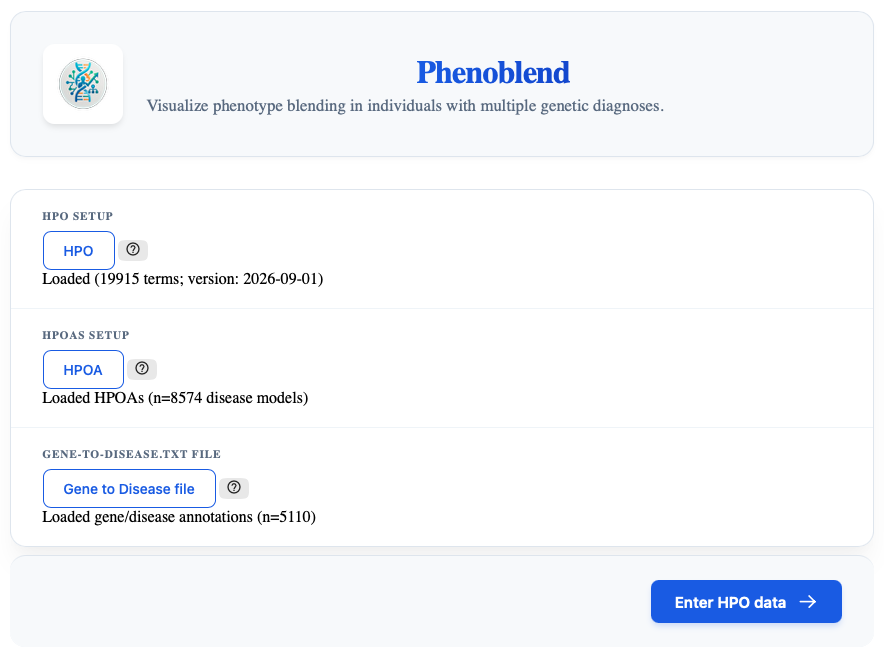

# Loading data

Users need to download three files from the [Human Phenotype Ontology (HPO)](https://hpo.jax.org/) website representing the ontology itself and the disease annotations. It is advisable to use the latest versions (updates are made about once every two months).

## hp.json

This is the file with the ontology data. Note that only the `hp.json` format is supported. Do not try to use the OBO or the OWL file.

- [HPO ontology file downloads](https://hpo.jax.org/data/ontology)

## phenotype.hpoa

This is the file that contains the HPO-based disease models for Mendelian diseases. Click on the orange button entitled `DOWNLOAD HPO ANNOTATIONS`

- [HPO Annotation download](https://hpo.jax.org/data/annotations)

## Genes to Disease

This is the file that links genes to the HPO disease annotation models. It is available on the same page as the `phenotype.hpoa` file. Click on the green button entitled `GENES TO DISEASE`.

::: tip File downloads
It is advisable (but not required) to download all three files to the same directory. Create a directory called `HPO Data` (or whatever you like) and download all three files there before running phenoblend.
:::

  *Figure 1. After successfully loading the three required input files, the home page will look like this.*

