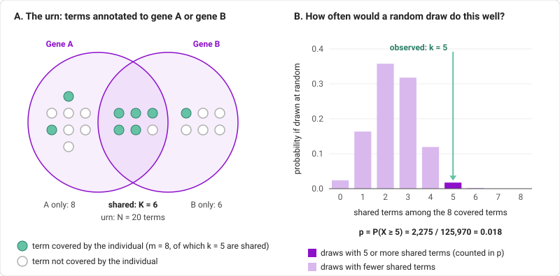

# Phenotype overlap enrichment test

This test addresses the question of the distribution of HPO terms reported in individuals with multiple genetic diagnoses (MGDs).
See [visualizations](./visualizations.md) for more background on the types of phenotypic overlap that can be observed. The clinical findings (represented as HPO terms) observed in an individual with an MGD correspond to four groups - assuming for this example that
the individual has two genetic diagnoses that we will call disease A (related to pathogenic variants in gene A) and disease B (related to pathogenic variants in gene B).

- An HPO term that is characteristic of disease A (and not disease B).
- An HPO term that is characteristic of disease B (and not disease A).
- An HPO term that is characteristic of both disease A and disease B.
- An HPO term that is not characteristic of either disease A or disease B.

See the explanation of the [pheno-upset plot](./upset.md) for a visualization of these four sets. In case studies at our institutions, we observed several cases in which HPO terms overlapping the annotations of the component diseases appeared at a high proportion. We therefore made the hypothesis that such _overlapping_ terms occur more frequently than expected by chance, and developed a statistical approach to evaluate the hypothesis.

## Phenotypic overlap

<figure class="figure-centered">
  
  <figcaption>
    Schematic example. The urn has 20 terms, 6 of them shared by both genes. The individual covers 8 urn terms, 5 of them shared. If 8 terms were drawn at random from the urn, 5 or more shared terms would occur in 2,275 of the 125,970 possible draws (p = 0.018).
  </figcaption>
</figure>

**Panel A** shows the terms annotated to gene A or gene B: the *urn*. The terms in the overlap are *shared*. The individual *covers* some of the terms (filled dots).

**Panel B** shows the distribution of random draws from an urn with balls representing HPO terms that are shared between disease A and B or are not shared. Most random picks contain about two shared terms. The individual has five, which almost never happens by chance, corresponding the p-value is statistically significant (p = 0.018).

## The four numbers

| Symbol | Name | Meaning |
|---|---|---|
| **N** | urn size | Number of HPO terms annotated to at least one of the genes (explicit annotations only, not their ancestors). |
| **K** | shared terms | Number of urn terms that all the genes account for (see below). |
| **m** | covered terms | Number of urn terms the individual covers. |
| **k** | covered shared terms | Number of the shared terms the individual covers. This is the statistic. |

The p-value is the probability, if the *m* covered terms were a random subset of the *N* urn terms, of getting **k or more** shared terms. A small p-value means the individual's features fall in the shared region more often than random.

### A very small example

Gene A is annotated with *Focal seizure*, *Tonic seizure* and *Short stature*. Gene B is annotated with *Focal seizure* and *Short stature*. The urn is those three terms (N = 3). Focal seizure and Short stature are shared (K = 2). The individual has Focal seizure and Short stature, so they cover two urn terms, both shared (m = 2, k = 2).

There are three equally likely ways to pick two terms from the urn:

| Random pick | Shared terms in it |
|---|---|
| Focal seizure, Tonic seizure | 1 |
| Focal seizure, Short stature | 2 |
| Tonic seizure, Short stature | 1 |

Two shared terms occur in 1 of the 3 picks, so p = 1/3. The p-value is the fraction of random picks that are as good as the observed one or better. With hundreds of terms the same count is made by a formula, not by listing the picks (see the details at the end).

## What "shared" and "covered" mean

Both follow the true-path rule: a term implies all of its ancestors (a focal seizure *is* a seizure).

**Covered.** The individual covers an urn term if the individual has that term or a more specific one. A gene annotated with *Seizure* is covered by an individual who has *Focal seizure*, but a gene annotated with *Focal seizure* is not covered by an individual who has only *Seizure*.

**Shared.** A term is shared by a set of genes if every gene is annotated with it or with a more specific term, and at least one of the genes is annotated with it explicitly. When the genes use terms at different levels, the more general term stands for the shared annotation and is counted once. If gene A has *Focal seizure* and gene B has *Seizure*, the shared term is *Seizure*. Ancestors that no gene annotates, such as *Abnormality of the nervous system*, are not counted.

This is the same definition as the columns of the [upset plot](upset.md), so the shared terms of a result are the terms in the column for the same genes.

## Reading a result

A result lists the genes tested, **N**, **K**, **m**, **k**, the **p-value**, and the probability of every possible number of shared terms (the bars in panel B).

::: tip No information in the data
The p-value is 1 when the test cannot tell anything: no terms are shared (K = 0), the individual covers no urn terms (m = 0), or the individual covers the whole urn. In these cases the result is marked as degenerate.
:::

## Things to keep in mind

- **A small urn cannot give a small p-value.** With N = 3 the smallest possible p-value is 1/3. The test only has power when the genes have enough annotated terms.
- **Several observed terms under one annotation count once.** If both genes are annotated with *Seizure* and the individual has *Focal seizure* and *Tonic seizure*, the urn term *Seizure* is covered once. The statistic counts urn terms, not the individual's own terms.
- **Terms outside the urn are ignored.** The individual's features that neither gene annotates take no part in the test. It asks whether, among the features the genes can explain, more fall in the shared part than expected.
- **The p-value is discrete.** With few terms only a handful of p-values are possible, so a result just below or above 0.05 is not meaningful on its own.
- **More than two genes.** For three or four genes the test uses the terms shared by *all* of them. That set is often small or empty, so these tests have little power and are often degenerate.
- **Many pairs.** If you test several pairs of genes, the p-values are not corrected for multiple testing.
- **A small p-value is evidence, not proof.** It is consistent with the phenotype reflecting both genes. It cannot tell you which gene a feature comes from, and shared features tend to be general ones.

<details>
<summary>Technical details</summary>

Under the null, the *m* covered terms are a uniform random subset of the *N* urn terms, so the number of shared terms among them, *X*, has a hypergeometric distribution:

```
P(X = x) = C(K, x) · C(N − K, m − x) / C(N, m)
```

where C(a, b) is the number of ways to choose b items from a. *X* can take values from max(0, m + K − N) to min(m, K). The one-sided p-value is

```
p = P(X ≥ k) = Σ over x ≥ k of P(X = x)
```

The p-value is computed by summing the probabilities of the upper tail directly, so very small values keep their precision. The distribution is computed exactly, from the ratio of neighbouring probabilities, and does not involve random sampling; running the test twice gives identical results.

The **mid-p value**, `P(X > k) + ½·P(X = k)`, is also reported. It is less conservative than `p` for discrete distributions, and under the null its average is ½, which makes it better suited to comparing many tests.

In the example figure, N = 20, K = 6, m = 8 and k = 5, so

```
p = [ C(6,5)·C(14,3) + C(6,6)·C(14,2) ] / C(20,8)
  = ( 6·364 + 1·91 ) / 125,970
  = 2,275 / 125,970
  ≈ 0.018
```

</details>
