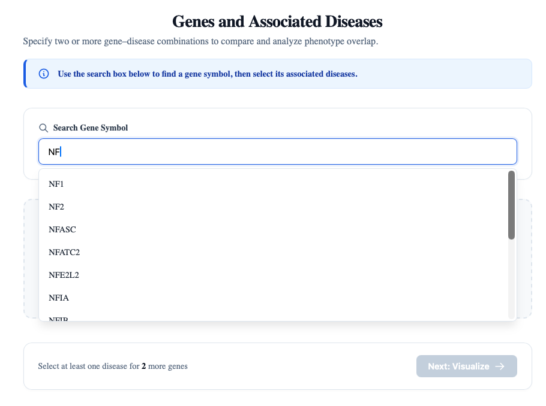
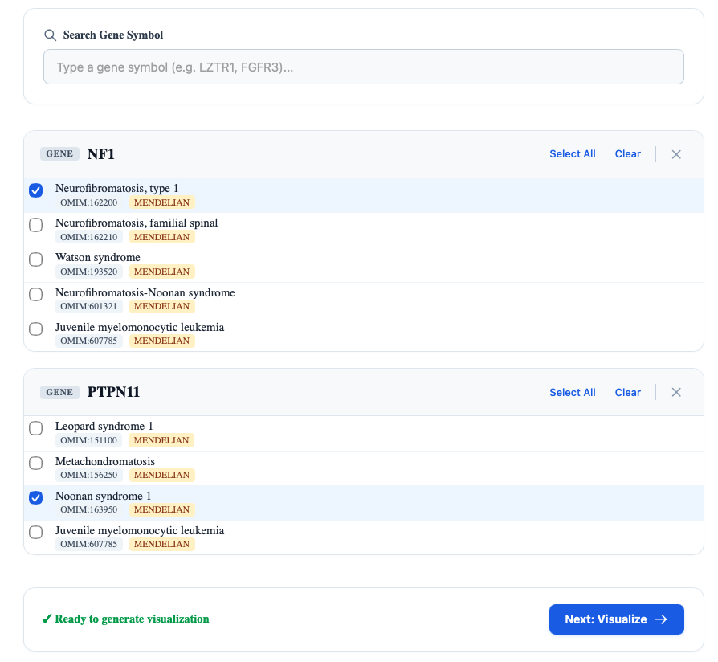

# Genes and diseases

Up to 5% of individuals with a diagnosed genetic disease have multiple distinct genetic diseases. The phenotypic profiles of affected individuals result from a “blend” of the clinical manifestations of each disease, whereby individual features  can either be assigned to a specific disease or be attributed to more than one disease. This situation has been referred to in the literature as blended phenotype, dual (or multiple) genetic diagnosis, Multilocus Genomic Variation, composite phenotype, co-occurrence of diseases, comorbidity, and others. For conciseness, we will use the acronym MGD (multiple genetic diagnosis). 

* For more background information, see: <a href="https://pubmed.ncbi.nlm.nih.gov/27959696/" target="__blank">Boycott KM, Innes AM (2017) When One Diagnosis Is Not Enough. <i>N Engl J Med</i></a>.

## Entering gene/disease data

Phenoblend is intended to display the blends and degree of overlap of the clinical manifestations of an individual with an MGD. Users of phenoblend need to enter the two (or more) gene symbols of the diseases that have been diagnosed. First, enter the gene symbol into the search box (which has autocomplete function).

  *Figure 3. Enter the symbol of a gene in which a causal variant was identified.*

If possible, indicate the specific disease diagnosis if a gene is associated with more than one disease. In the following example, we have entered information about an individual diagnosed with both [Neurofibromatosis type 1](https://omim.org/entry/162200) and [Noonan syndrome 1](https://omim.org/entry/163950?search=noonan&highlight=noonan)

  *Figure 4. If possible, specify the disease diagnosis.*

If the clinical diagnosis at the disease level is unknown, users can choose all diseases, and the disease model will contain the union of observed HPO terms of all of the diseases.