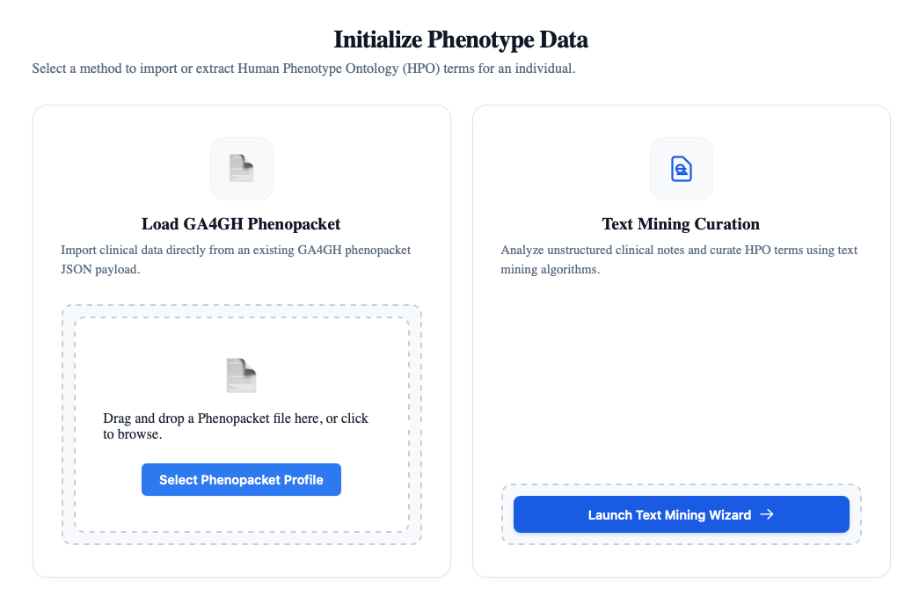

# Input data

Users need to input a list of [Human Phenotype Ontology (HPO)](https://hpo.jax.org) representing the observed clinical manifestations of
an individual with a multiple genetic diagnosis. The phenoblend analysis does not use excluded HPO terms, and if a phenopacket contains excluded terms, they will be ignored.

HPO data can be entered by importing a [Global Alliance for Genomics and Health](https://www.ga4gh.org) (GA4GH) [phenopacket](https://phenopacket-schema.readthedocs.io/en/latest/). Currently, version 2 of the Phenopacket Schema is supported.

Alternatively, users can enter a clinical text with a summary of the clinical manifestations using a text-mining dialog. Phenoblend will automatically remove any mined terms that are labeled as excluded. 

  *Figure 2. Load either a phenopacket or use text mining to extract a list of observed HPO terms.*
