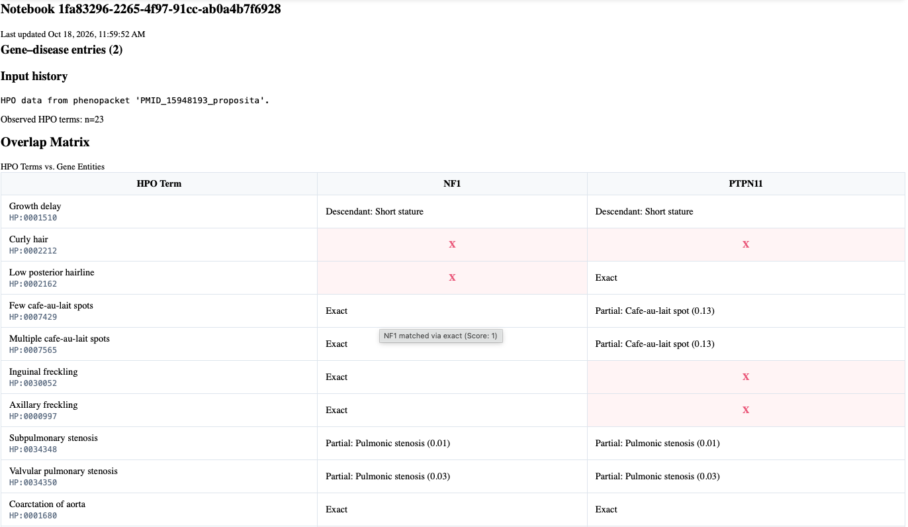

# Notebook

The notebook view provides a detailed breakdown of the phenotype counts that can be used to guide detailed analysis and to understand the graphics.

The structure of the notebook is still a work in progress (TODO: finalize).

  *Figure ?. The notebook page provides details about the phenotypic match procedures used to create the graphics.*