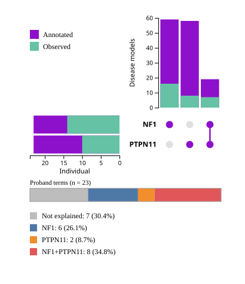

# Upset plot

UpSet plots are a data visualization method for showing set data with intersecting sets. UpSet shows intersections in a matrix, with the rows of the matrix corresponding to the sets, and the columns to the intersections between these sets (or vice versa). The size of the sets and of the intersections are shown as bar charts [wikipedia](https://en.wikipedia.org/wiki/UpSet_plot).

We adapt the upset approach to show the distribution of phenotype melding and disease overlap. In the example, the horizontal bars on the left show
the count of HPO terms in the disease model related to each of the genes in the MGD. The HPO terms that were also observed in the proband are shown in green.  In our example, the phenopacket comprised 23 observed HPO terms. 16 of these terms are represented to Neurofibromatosis type 1. The HPO disease model has 44 additional HPO terms (shown in purple), corresponding to a total of 60 HPO terms (total width of the bar). Analogously, 8 of the observed proband terms correspond to features of Noonan syndrome type 1 (*PTPN11*). 

13 of the proband terms correspond to the overlap of Neurofibromatosis type 1 and Noon syndrome type 1 (this is the third vertical bar, showing the intersection). The other two vertical bars show terms that are representing only by NF1 or NS1.

<figure>
  
  <figcaption>
    Data from Bertola DR, et al. (2005) <a href="https://pubmed.ncbi.nlm.nih.gov/15948193/">Neurofibromatosis-Noonan syndrome: molecular evidence of the concurrence of both disorders in a patient. <em>Am J Med Genet A</em> <strong>136</strong>:242-5</a>
  </figcaption>
</figure>

