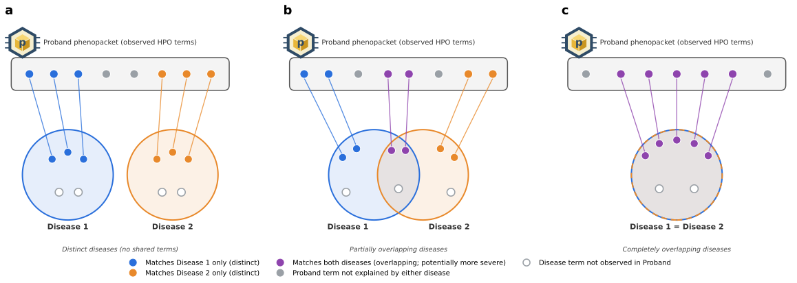

# Visualizations

The phenotypic features of an individual being evaluated for suspected MGD can be said to be “melded” if the features are attributable to more than one Mendelian disease. Phenoblend compares the features (HPO terms) of the individual proband with those of computational disease models represented in the HPO project. Phenoblend assigns HPO terms observed in the proband to one or more diseases using the HPO disease models and an ontology-aware matching approach. The involved diseases display various degrees of clinical overlap depending on the proportion of shared HPO terms, ranging from completely distinct to entirely overlapping.

  *Figure 5. Phenotype blending and disease overlap.*

## Three visualizations

Phenoblend offers three types of visualization

* **1.** [Overlap](overlap.md)
* **2.** [Phenotype upset](upset.md)
* **3.** [Phenotype profile](profile.md)